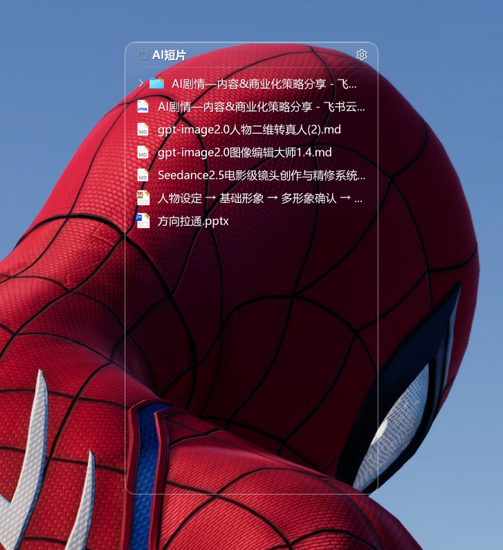
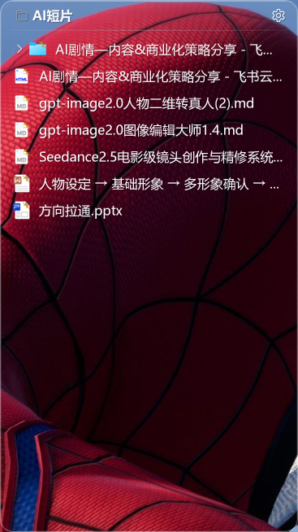
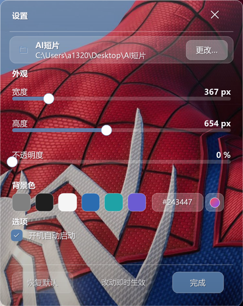
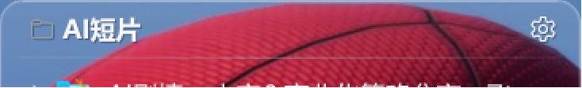

<p align="center">
  
</p>

<h1 align="center">GlassDock</h1>

<p align="center">
  <b>把任意文件夹，变成桌面上的一块活玻璃。</b><br>
  <i>Turn any folder into a living piece of glass on your desktop.</i>
</p>

<p align="center">
  <a href="#中文"></a>
  <a href="#english"></a>
  
  
  
  <a href="LICENSE"></a>
</p>

<p align="center">
  <a href="#中文">中文</a> · <a href="#english">English</a> ·
  <a href="docs/GLASSDOCK-FULL-MANUAL.md">完整手册</a> ·
  <a href="docs/P7_CHANGELOG.md">变更日志</a>
</p>

---

<a id="中文"></a>

## 中文

### 它是什么

GlassDock 是一个 **Windows 桌面文件夹小组件**：选定一个文件夹，它的内容就以一列清单的形式贴在桌面上，双击即用系统默认程序打开。面板是**逐像素真透明**的玻璃——壁纸是什么，它就透什么，包括 Wallpaper Engine 的动态场景；不截屏、不模糊、没有"上一帧画面"的残留。

它恪守桌面组件的本分：**不置顶、不抢焦点**，任何应用窗口都自然地盖在它上面；`Win+D` 回到桌面，它还在原位；Explorer 重启、换分辨率、插拔显示器，它自己回到桌面层。文件夹里新增、删除、改名，列表**实时跟着变**，不需要任何手动刷新。

单文件 exe，C++17 / Win32 / GDI+ 手写，无 .NET、无运行时依赖、无第三方库。

### 特性

- **真·透明玻璃**：`UpdateLayeredWindow` + 预乘 alpha 表面，背景像素 alpha=0，DWM 实时合成桌面内容；圆角玻璃边框、顶部高光与内缘反光，读出"有厚度的玻璃"而非贴片。
- **桌面驻留**：三级桌面宿主探测（`SHELLDLL_DefView` → `Program Manager` → 明确失败），锚定在壁纸层之上、所有普通窗口之下；`Win+D` 状态机 + 单飞延迟恢复；监听 `TaskbarCreated` 应对 Explorer 重启；`WM_DISPLAYCHANGE` / `WM_SETTINGCHANGE` 自动贴回可见区域。
- **实时刷新**：`ReadDirectoryChangesW` 递归监听根目录，120 ms 去抖合并通知；刷新保留已展开的目录与滚动位置，列表不跳。
- **系统级字体观感**：读取系统「桌面图标字体」（`HKCU\...\WindowMetrics\IconFont`），3 倍超采样灰度抗锯齿——边缘是连续 alpha 渐变，顺滑、无锯齿、无 ClearType 彩色毛边，混排字号观感统一。
- **全部可调，即时生效**：宽 / 高 / 背景浓度滑块，6 个预设色 + HEX 输入 + 系统取色器；拖动滑块主窗口立刻变化，没有"保存"按钮。
- **树状列表**：文件夹优先排序，三角展开 / 收起，滚轮滚动，悬停高亮pill，双击打开。
- **叫得回、丢不了**：`Ctrl+Alt+G` 全局热键、托盘图标、单实例互斥（二次启动唤回已有窗口）；标题栏故意不放关闭按钮，手滑点不掉。
- **轻量**：常驻内存约 20 MB；真透明模式下背景零重绘开销，仅 1 s 一次的桌面守卫定时器。

### 截图

| 主界面（真透明，透出壁纸） | 设置面板 | 头部细节 |
| :---: | :---: | :---: |
|  |  |  |

> 截图由程序自身的真 alpha 表面导出后与壁纸合成（`WM_SNAP` 调试消息），与桌面实际观感一致。

### 安装与使用

**安装版**：下载 [`release/GlassDock-Setup-1.0.0.exe`](release/GlassDock-Setup-1.0.0.exe)，双击安装，可选立即启动；自带卸载项（设置 → 应用 → GlassDock）。
**便携版**：下载 [`release/GlassDock.exe`](release/GlassDock.exe)，放任意目录双击即可，配置写在 `%APPDATA%\GlassDock\`。

| 操作 | 效果 |
| --- | --- |
| 拖动标题栏 / 右下角 | 移动 / 缩放（位置与尺寸自动记忆，出屏自动贴回） |
| 双击文件、文件夹 | 系统默认程序打开 |
| 点文件夹左侧三角 | 展开 / 收起子项 |
| 滚轮 | 滚动列表 |
| 齿轮 / 右键 → 设置 | 打开设置面板 |
| 右键 | 选择文件夹 / 设置 / 刷新背景 / 隐藏到托盘 / 退出 |
| `Ctrl+Alt+G` / 托盘双击 / 再启动一次 | 唤回并锚定到桌面层（不置顶、不抢焦点） |

**它"看不见"了？** 它本来就压在桌面层：浏览器、游戏在前台时它被盖住是**有意的**。回桌面就在；若连桌面都找不到，按 `Ctrl+Alt+G`、点托盘、或再双击一次快捷方式，任意一条都能叫回。

### 设置面板

| 设置 | 说明 |
| --- | --- |
| 文件夹卡片 | 点整张卡片换目录 |
| 宽度 / 高度 | 240–1000 / 240–1200 px，拖动即刻缩放 |
| 不透明度 | 0 = 全透只留文字与玻璃边，100 = 纯色面板 |
| 背景色 | 6 预设 + HEX + 系统取色器 |
| 开机自动启动 | 登录后自动出现 |
| 恢复默认 / 完成 | 一键还原 / 关闭面板（改动早已即时生效） |

拖动与缩放的实时刷新固定 60 Hz。配置文件：`%APPDATA%\GlassDock\config.ini`（UTF-16 LE），键含 `folder / x / y / width / height / opacity / accent / autostart / foldersFirst / showExt`。

### 从源码构建

环境：MinGW-w64 x86_64（g++ 16+，UCRT），Windows 10/11 SDK 头文件随 MinGW 提供。

```powershell
# 修改 build.ps1 顶部的 $Gpp / $Windres 路径后：
.\build.ps1
```

产物：`GlassDock.exe`、`GlassDock.exe.manifest`、`installer\setup.exe`、`release\GlassDock-Setup-1.0.0.exe`。
主程序单条命令亦可：

```powershell
g++ src\GlassDock.cpp src\resource.o -o GlassDock.exe -mwindows -municode -O2 -s -static `
    -lgdiplus -ldwmapi -lshell32 -lcomctl32 -lole32 -luuid -lshlwapi -lgdi32 -luser32 -ladvapi32
```

### 技术要点

- **真透明而非 Acrylic**：DWM 私有 Acrylic 接口在本机 Win11 实测无效；逐像素 alpha 靠 PARGB 位图 + `ULW_ALPHA` 提交，静态 / 动态壁纸通吃。
- **文字**：GDI 栅格化覆盖率蒙版 → 3x 超采样盒式降采样 → 预乘合成进 PARGB；不用 GDI+ 软抗锯齿（发虚）、不用 ClearType（透明窗下彩色毛边）。
- **Z 序**：锚定桌面宿主之上垫底（与桌面图标同级），仅当被埋到宿主之下才重锚；不用 `HWND_BOTTOM`（会钻到壁纸后面）。
- **设置面板**：独立 `WS_POPUP` 自绘玻璃窗，全部控件手绘；仅激活时临时置顶，失焦即恢复。
- **安装器**：`installer/setup.cpp` 内嵌主程序与清单，装到 `D:\GlassDock`（D 盘不可用退回 `%LOCALAPPDATA%`），建快捷方式与卸载项。

### 文档索引

- [`docs/GLASSDOCK-FULL-MANUAL.md`](docs/GLASSDOCK-FULL-MANUAL.md) — 完整技术手册（架构 / 消息 / 布局 / 测试门）
- [`docs/PROJECT_GUIDE.md`](docs/PROJECT_GUIDE.md) — 项目导览
- [`docs/P7_CHANGELOG.md`](docs/P7_CHANGELOG.md) — 逐轮变更日志（P0–P11）
- [`docs/P7_TEST_REPORT.md`](docs/P7_TEST_REPORT.md) / [`docs/P7_IMPLEMENTATION_PLAN.md`](docs/P7_IMPLEMENTATION_PLAN.md) — 桌面驻留升级的测试与实施记录
- [`docs/DESKTOP-EMBED-ASSESSMENT-2026-11-24.md`](docs/DESKTOP-EMBED-ASSESSMENT-2026-11-24.md) — 桌面嵌入方案评估

### 已知限制

- 文字固定浅色，不随壁纸明暗自动反色（深色壁纸观感最佳）。
- 真透明玻璃不做背景模糊（模糊需要截屏，会破坏"活玻璃"）；浓度滑块提供的是着色而非磨砂。
- 仅在 Windows 11 26H2（2560×1440 @125%）实测；Win10 理论兼容，未逐版本验证。

### 许可

[MIT](LICENSE) © 2026 GlassDock

---

<a id="english"></a>

## English

### What it is

GlassDock is a **Windows desktop folder widget**: pick a folder and its contents live on your desktop as a clean list — double-click to open with the shell default. The panel is **true per-pixel-alpha glass**: whatever your wallpaper is, it shows through, including Wallpaper Engine's live scenes. No screen capture, no blur, no stale "last frame" ghost.

It behaves like a desktop citizen: **never topmost, never steals focus**; every application window naturally covers it; `Win+D` brings you back to it in place; it re-anchors itself after Explorer restarts, resolution changes and monitor hot-plug. Files added, removed or renamed in the folder appear **live** — no manual refresh anywhere.

One self-contained exe, hand-written C++17 / Win32 / GDI+. No .NET, no runtime dependencies, no third-party libraries.

### Features

- **True see-through glass** — premultiplied-alpha surface submitted via `UpdateLayeredWindow`; background pixels carry alpha 0 so DWM composites the live desktop through it. Rounded glass border, top sheen and an inner edge catch-light give it real thickness.
- **Desktop residency** — three-stage desktop-host probe (`SHELLDLL_DefView` → `Program Manager` → explicit failure), anchored above the wallpaper band and below every ordinary window; a `Win+D` state machine with single-flight deferred recovery; `TaskbarCreated` listener for Explorer restarts; keep-on-screen on display/settings changes.
- **Live refresh** — recursive `ReadDirectoryChangesW` watch with a 120 ms debounce; expanded folders and scroll position survive every rebuild.
- **System-native typography** — reads the shell icon font (`IconFont` registry metric) and renders it with 3× supersampled grayscale anti-aliasing: continuous alpha ramps, silky edges, no stair-stepping, no ClearType colour fringing on transparent surfaces.
- **Everything adjustable, instantly** — width / height / tint-opacity sliders, six preset accents plus HEX entry and the system colour picker; the widget reacts while you drag. No save button.
- **Tree list** — folders-first sorting, expand/collapse chevrons, wheel scrolling, hover pills, double-click to open.
- **Always recoverable** — `Ctrl+Alt+G` hotkey, tray icon, single-instance mutex (a second launch summons the existing window); deliberately no close button on the title bar.
- **Light** — ~20 MB resident; zero background repaint cost in see-through mode, only a 1 s desktop-guard tick.

### Screenshots

| Widget (true transparency) | Settings | Header detail |
| :---: | :---: | :---: |
|  |  |  |

> Captured from the widget's own true-alpha surface (`WM_SNAP` debug message) and composited over the wallpaper — identical to what DWM shows on the desktop.

### Install & use

**Installer**: [`release/GlassDock-Setup-1.0.0.exe`](release/GlassDock-Setup-1.0.0.exe) — double-click, optionally launch now; registers an uninstall entry.
**Portable**: [`release/GlassDock.exe`](release/GlassDock.exe) — run from anywhere; config lives in `%APPDATA%\GlassDock\`.

| Action | Effect |
| --- | --- |
| Drag title bar / bottom-right corner | Move / resize (remembered; clamped back on-screen) |
| Double-click a file or folder | Open with the shell default |
| Click a folder's chevron | Expand / collapse |
| Mouse wheel | Scroll the list |
| Gear icon / right-click → Settings | Open the settings panel |
| Right-click | Pick folder / settings / refresh backdrop / hide to tray / exit |
| `Ctrl+Alt+G`, tray double-click, relaunch | Summon and re-anchor to the desktop band (no topmost, no focus steal) |

**Can't see it?** It lives *under* your windows by design. Return to the desktop and it is there; if even the desktop seems empty, any of `Ctrl+Alt+G`, the tray icon, or a second launch brings it back.

### Settings

Folder card, width (240–1000 px), height (240–1200 px), tint opacity (0 = pure glass, 100 = solid slab), accent (6 presets + HEX + system picker), run-at-startup, reset-to-defaults. Drag/resize repaint is fixed at 60 Hz. Config: `%APPDATA%\GlassDock\config.ini` (UTF-16 LE).

### Build from source

MinGW-w64 x86_64 (g++ 16+, UCRT). Edit the toolchain paths at the top of `build.ps1`, then run it; or compile the main program directly:

```powershell
g++ src\GlassDock.cpp src\resource.o -o GlassDock.exe -mwindows -municode -O2 -s -static `
    -lgdiplus -ldwmapi -lshell32 -lcomctl32 -lole32 -luuid -lshlwapi -lgdi32 -luser32 -ladvapi32
```

### Engineering notes

- **True alpha, not Acrylic** — the private DWM acrylic API proved ineffective on this Win11 build; per-pixel alpha via PARGB + `ULW_ALPHA` works over static and live wallpapers alike.
- **Text** — GDI coverage mask → 3× supersample → box-average down → premultiplied composite. Neither GDI+'s soft rasteriser (washed-out stems) nor ClearType (colour fringes on layered windows).
- **Z-order** — parked just above the desktop host (same band as desktop icons); re-anchored only if buried beneath it. `HWND_BOTTOM` is avoided because it can sink behind the wallpaper.
- **Settings panel** — a separate owner-drawn `WS_POPUP` glass window; topmost only while active.
- **Installer** — embeds the exe + manifest, installs to `D:\GlassDock` (falls back to `%LOCALAPPDATA%`), creates shortcuts and an uninstall entry.

### Docs

[Full manual](docs/GLASSDOCK-FULL-MANUAL.md) · [Project guide](docs/PROJECT_GUIDE.md) · [Changelog](docs/P7_CHANGELOG.md) · [Desktop-residency test report](docs/P7_TEST_REPORT.md) · [Implementation plan](docs/P7_IMPLEMENTATION_PLAN.md) · [Embed assessment](docs/DESKTOP-EMBED-ASSESSMENT-2026-11-24.md)

### Known limitations

- Text is fixed light-on-glass; it does not auto-invert over bright wallpapers (dark wallpapers look best).
- No background blur by design — blurring would require screen capture and break the "living glass"; the opacity slider tints, it does not frost.
- Verified on Windows 11 26H2 (2560×1440 @125%); Windows 10 is expected to work but not exhaustively tested.

### License

[MIT](LICENSE) © 2026 GlassDock