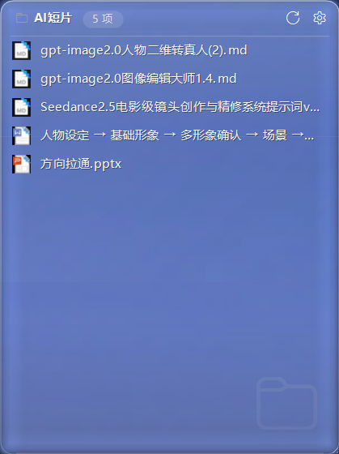

# GlassDock

一个 Windows **桌面**文件夹小组件：把任意文件夹的内容以列表贴在桌面上，双击直接打开；背景是自绘的“毛玻璃 / 亚克力”质感，长宽、透明度、背景色都能实时调。

它只待在桌面上：不会盖住你正在用的窗口，切到别的程序时自动沉到桌面层，`Win+D` 回到桌面它还在。




## 功能特性

- **文件夹列表**：指向任意文件夹，文件夹优先排序，双击用系统默认程序打开；文件夹行可点三角展开 / 收起，滚轮滚动。
- **真·桌面玻璃**：背景来自你桌面真正的壁纸层（按 Windows 自己的壁纸文件与铺放方式还原），不是“上一次截屏”的残留画面，所以后面是什么就透什么；换壁纸、换分辨率会自动跟上。
- **只在桌面出现**：窗口不置顶、也不抢焦点（`WS_EX_NOACTIVATE`），点它不会把它“激活到前台”或弄丢；任何程序窗口都盖在它上面，切走时它自动回到桌面层，不挡游戏。
- **点它不会消失**：放在桌面层用的是“插到最下面那个普通窗口之后”，而不是容易钻到壁纸后面的 `HWND_BOTTOM`，所以回到桌面后点它、点空白处，它都乖乖待在原位。
- **液体玻璃质感**：壁纸先做多级双三次模糊并轻微提饱和，再上极薄的色调（强度按曲线衰减，55 只是一层淡淡的颜色，不是色板），配斜向高光、顶部薄纱、底边反光和双线玻璃边；默认 40 档基本就是“透明玻璃贴纸”。
- **全部可调**：宽度 240–1000 px、高度 240–1200 px、不透明度（背景浓度）0–100%、背景色（6 个预设 + 系统取色器）。
- **实时预览**：设置面板里拖动滑块，小组件立刻变化，**不需要点保存**；数值改动即时写入配置。
- **独立设置窗口**：设置是单独的玻璃窗口，和小组件同一套毛玻璃质感，可拖动、可随意关闭；打开时置顶方便操作，失焦后自动恢复普通窗口行为。
- **字体跟随系统**：标题、列表、设置全部使用系统 UI 字体，换主题 / 换字体自动跟随。
- **不会丢**：标题栏故意不放关闭按钮，手滑也点不掉；想隐藏就右键 → 隐藏到托盘，或 `Ctrl+Alt+G`。托盘有图标、桌面 / 开始菜单快捷方式，再双击一次就能叫回来（单实例，不会开出第二个）。
- **关不掉 / 藏不住兜底**：每秒巡检一次，一旦发现被系统藏起来或被压到壁纸下面，会自己无焦点地回到桌面层；只有你亲手“隐藏到托盘”时它才安静待着。
- **轻量原生**：C++17 / Win32 / GDI+，单文件 exe，无 .NET、无运行时依赖，常驻内存约 20 MB；静态壁纸下背景几乎零开销，被窗口遮住时自动暂停刷新。
- **一键安装 / 卸载**：双击 `GlassDock-Setup-1.0.0.exe` 即安装，自带卸载（设置 → 应用 → GlassDock → 卸载）。

## 快速开始

1. 下载 `release/GlassDock-Setup-1.0.0.exe`。
2. 双击安装 → 选择“是”立即启动。
3. 桌面和开始菜单会生成 GlassDock 快捷方式。
4. 点标题栏的齿轮打开设置，选文件夹、拖滑块调到喜欢的样子。

## 操作说明

| 操作 | 效果 |
| --- | --- |
| 拖动标题栏 | 移动小组件（位置自动记忆） |
| 拖动右下角 | 调整大小（超出屏幕会自动贴回可见区域） |
| 双击文件 / 文件夹 | 用默认程序打开 |
| 点击文件夹左侧三角 | 展开 / 收起子项 |
| 滚轮 | 滚动列表（双缓冲绘制，不闪） |
| 右键 | 菜单：选择文件夹 / 设置 / 刷新背景 / 开机自启 / 隐藏到托盘 / 退出 |
| 标题栏图标（左 → 右） | 刷新背景 / 设置 |
| `Ctrl+Alt+G` | 全局热键，把小组件叫到桌面最前 / 隐藏 |
| 托盘图标（左键 / 双击） | 显示 / 隐藏；右键有菜单 |

### 它为什么“看不见”了？

它是桌面小组件，本来就压在桌面层：浏览器、游戏、聊天窗口在前台时，它会被正常盖住 —— 这是有意的。把窗口最小化、按 `Win+D` 回桌面，它就在原位；**点它、点桌面空白处都不会让它消失**（它从不抢焦点）。

如果连桌面都找不到它，按顺序试任意一条：

1. 按 `Ctrl+Alt+G`（会把小组件临时置顶 5 秒让你看到，然后自动回桌面层）；
2. 点系统托盘里的 GlassDock 图标（Win11 在任务栏右侧 `^` 展开面板里，可拖到任务栏常显）；
3. 再双击一次桌面 / 开始菜单的 GlassDock 快捷方式（单实例，会直接把已有窗口叫回来）；
4. 托盘右键 → 退出，再双击快捷方式重启（配置和位置都会保留）。

> 备注：`Win+D` 会把桌面小组件一起最小化，程序收到最小化后会自动恢复并留在桌面层，所以回到桌面时它仍然在。

## 设置项

| 设置 | 说明 |
| --- | --- |
| 文件夹卡片 | 点整张卡片选择要展示的文件夹 |
| 宽度 / 高度 | 小组件尺寸（像素），拖动即刻缩放 |
| 不透明度（背景浓度） | 0 = 只模糊不上色；数值按曲线衰减，55 已经很清透，100 = 浓色 |
| 背景色 | 6 个预设 + “自定义…”系统取色器 |
| 开机自动启动 | 登录后自动出现 |
| 恢复默认 | 一键还原默认尺寸 / 颜色 / 透明度 |

底部提示“改动即时生效”：所有滑块与色板松开即写入配置，没有“保存 / 取消”按钮；“完成”只是关掉面板。

## 配置文件

`%APPDATA%\GlassDock\config.ini`，节 `[GlassDock]`：

| 键 | 含义 |
| --- | --- |
| `folder` | 展示的文件夹路径 |
| `width` / `height` | 宽 / 高（像素） |
| `x` / `y` | 屏幕坐标 |
| `opacity` | 背景着色强度 0–100 |
| `accent` | 背景色（RRGGBB） |
| `topmost` | 兼容保留，固定写 0（桌面小组件不置顶） |
| `autostart` | 开机自启（0/1） |
| `foldersFirst` / `showExt` | 文件夹优先 / 显示扩展名（0/1） |

卸载时会连同配置文件一起清理。

## 从源码构建

环境：MinGW-w64（x86_64，g++ 16+，含 GDI+ / DWM / Shell / Common Controls）。

```powershell
# 按需修改 build.ps1 里的 MinGW 路径后执行
.\build.ps1
```

产物：

- `GlassDock.exe` — 主程序
- `GlassDock.exe.manifest` — 并行清单（DPI 感知 + Common Controls v6）
- `installer\setup.exe` — 安装器
- `release\GlassDock-Setup-1.0.0.exe` — 可分发安装包

## 上传到 GitHub

1. 新建仓库，`git init` 后提交源码（`.gitignore` 已排除构建产物与 `release/`）。
2. Releases 里新建版本，把 `release/GlassDock-Setup-1.0.0.exe` 作为附件上传。
3. README 里的 `docs/screenshot.png`、`docs/settings.png` 会直接显示。

## 技术要点

- 主程序：C++17 + Win32 + GDI+，单文件 `src/GlassDock.cpp`，无第三方依赖。
- 桌面层定位：窗口带 `WS_EX_NOACTIVATE`，点击、拖动都不抢前台焦点；层级上“插到最下面那个普通窗口之后”（`SitOnDesktop`，跳过 shell 窗口和 topmost 窗口），所以它永远压在壁纸/图标上面、所有应用窗口下面，也不会像 `HWND_BOTTOM` 那样在“显示桌面”后钻到壁纸底下——那正是以前“点一下就消失”的原因。收到 `SIZE_MINIMIZED`（`Win+D`）立刻恢复显示。
- 桌面守卫：`1 s` 定时器巡检，窗口被 Explorer 藏起来 / 最小化 / 被压到壁纸下时，无焦点地 `SW_SHOWNOACTIVATE` + `SitOnDesktop` 复位；每 5 s 重新确认一次层级。只有用户主动“隐藏到托盘”后才停止干预（`g_userHidden`）。
- 没有关闭按钮：标题栏只保留刷新与设置，避免误点导致“它不见了”；隐藏 / 退出都在右键菜单和托盘里，属于明确操作。
- 显式呼出（热键 / 托盘 / 二次启动）才临时 `TOPMOST` 5 秒让你看到，随后自动取消置顶并回到桌面层；后台进程只有 `TOPMOST` 能可靠越过前台窗口，普通 `HWND_TOP` 会被系统忽略。
- 背景来源：优先尝试 `PrintWindow(Progman, PW_RENDERFULLCONTENT)` 拿实时桌面层（动态壁纸可用时就是当前帧）；拿不到时按 `HKCU\Control Panel\Desktop\WallPaper` 的壁纸文件，结合 `WallpaperStyle`（填充 / 适应 / 拉伸 / 居中 / 平铺）还原桌面壁纸并裁到窗口位置；两者都失败才短暂隐藏自己抓一次屏。静态壁纸下只有壁纸文件变化才重建，CPU 基本为零。
- 液体玻璃渲染：裁切 → 多级双三次金字塔降采样（近似高斯模糊）→ 轻微提饱和 → 按 `opacity^2.2 * 0.30` 上色调（颜色越淡越像玻璃，滑块 55 只有约 4% 色）→ 极淡可读性蒙版；再叠斜向高光、顶部薄纱、底边反光与顶亮底暗的 1 px 玻璃边。文字颜色按最终背景亮度自动在深 / 浅之间切换。
- 刷新策略：`900 ms` 定时器只在“窗口可见且没有被其他窗口遮住”时才刷新背景（用 `WindowFromPoint` 判断），全屏游戏 / 前台程序盖住时自动跳过。
- 绘制：全局双缓冲（BackBuffer + `BitBlt`），滚动列表不闪烁。
- 设置面板：`WS_POPUP` 无边框自绘窗口，滑块 / 复选框 / 色板 / 按钮全部手绘；`WS_EX_TOPMOST` 只在被激活时生效，失焦即恢复普通层级；改动即写配置并即时刷新主窗口。
- 托盘 / 热键 / 单实例：`Shell_NotifyIcon` + `RegisterHotKey` + 命名互斥体，第二次启动会把已有窗口叫到最前。
- 安装器：`installer/setup.cpp` 把主程序与清单作为资源内嵌，安装到 `%LOCALAPPDATA%\Programs\GlassDock`，创建快捷方式与卸载项；卸载走 `GlassDock.exe --uninstall`，延时清理安装目录与配置。

> 说明：这是自绘毛玻璃，不是 DWM 的私有 Acrylic API —— 那套接口在本机（Win11 26300）实测无效（连纯色 alpha 都不生效）。桌面小组件只需要“背后的桌面”，因此用壁纸层重建；动态壁纸（Wallpaper Engine 等）能抓到实时层就跟随，抓不到时会退回静态壁纸。

## 许可

MIT License，详见 [LICENSE](LICENSE)。
